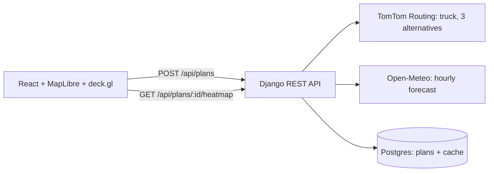

# Weather-Aware Truck Routing

A React + Django app that helps a truck driver pick the safest route. It generates three truck routes, samples the forecast at each checkpoint **for the time the truck will actually be there**, classifies risk with the assessment's wind/rain/snow and load rules, and recommends a route, balancing weather risk against travel time.

- **Live app:** https://truck-weather.vercel.app
- **API:** https://backend-production-4052b.up.railway.app/api/health
- **Walkthrough (Loom):** _TBD_

## Features

- **Inputs:** origin and destination (US place search), departure time in the origin's local time, and load weight. Options: checkpoint interval (10 / 25 / 50 mi), conservative mode (classify on gusts), and Hours-of-Service stops.
- **Three route options** from TomTom's truck routing, which accounts for vehicle weight, departure time and traffic.
  - The options are the fastest route plus the fastest alternatives that differ from those already picked by at least 30% of their length, and take at most 1.4× the fastest time.
  - If that doesn't produce three routes, extra options are forced through a point off each side of the main route. In this fallback, forced and TomTom alternatives alike may take up to 1.6× the fastest time.
- **Checkpoints** every N road miles. Each has an ETA (including HOS breaks and rests), weather, risk level, the factor that set the level, and a forecast-confidence label.
- **Recommendation** with a one-sentence explanation, the extra time it costs compared with the fastest route (if any), a reason on every other route card, and a table of the criteria in priority order with the deciding row highlighted.
- **Map** (MapLibre + deck.gl):
  - all three routes, with the selected one colored by risk;
  - checkpoint tooltips and HOS stop markers;
  - a **corridor weather heatmap** with a **0–48 h slider** anchored at departure, a play button, and Risk / Wind / Rain / Snow layers;
  - a truck marker that shows where the driver will be at the slider time.
- **Shareable plans:** each plan is saved and gets a `/trip/:id` link.

## How the risk is computed

All of this lives in [`backend/domain/`](backend/domain), plain Python with no Django dependency, covered by table-driven tests.

### Risk table

| Condition | Low | Moderate | High | Severe | No Travel |
|---|---|---|---|---|---|
| Wind (mph) | < 25 | 25 – <35 | 35 – <45 | 45 – <55 | ≥ 55 |
| Rain (in/hr) | < 0.10 | 0.10 – <0.25 | 0.25 – <0.50 | 0.50 – 1.00 | > 1.00 |
| Snow (in/hr) | < 0.5 | 0.5 – <1.0 | 1.0 – <2.0 | 2.0 – 3.0 | > 3.0 |

- **Band edges:** each band includes its lower bound, and bands are continuous floats, so 34.6 mph is Moderate. The brief writes the top rain and snow bands as "> 1.00" and "> 3.0", so exactly 1.00 in/hr of rain is Severe.
- **Load rules:** these only ever raise a level.
  - ≥ 55 mph → No Travel for any load.
  - 45–54 mph with load > 30,000 lb → No Travel.
  - 35–44 mph with load > 40,000 lb → Severe.
  - Exactly 30,000 or 40,000 lb does not trigger a rule.
- **Checkpoint level** = the worst of wind, rain and snow, then load escalation. Tooltips name the factor that decided it, e.g. "47 mph wind + 42,000 lb load → No Travel".
- **Wind:** the rules use sustained 10 m wind by default. **Conservative mode** classifies on gusts instead.
- **Rain** = Open-Meteo `rain + showers`. `precipitation` is not used because it also counts snow as water equivalent.
- **Snow** = `snowfall`, which is snow depth per hour.
- **Missing forecast data is not "Low".** Checkpoints without a forecast are marked *No data*, excluded from the average, and their miles reported separately. This happens beyond the forecast horizon, or for a cell where Open-Meteo still failed after retries.

### Sampling and ETAs

- **Checkpoint placement.** Checkpoints sit at 0, N, 2N, … road miles plus the destination. Positions follow TomTom's road distance (its `progress` array), so mileage matches the route summary.
- **Mileage per checkpoint.** Each checkpoint represents half the distance to each neighbor, so per-level miles add up exactly to the route length.
- **ETA.**
  - Drive time comes from TomTom's traffic-aware cumulative travel time, interpolated between progress points.
  - With **HOS** on (FMCSA, property-carrying), there is a 30-minute break after 8 hours of driving and a 10-hour rest after 11 hours. A rest resets both clocks.
  - Not modeled, and documented as limitations: the 14-hour window (it never binds when the driver only drives), 60/70-hour cycles, and sleeper-berth splits.
- **Matching weather to time.** Open-Meteo's hourly `rain`, `showers`, `snowfall` and gusts describe the *preceding* hour. For an ETA *t* the app therefore uses the hour ending at or after *t*. Only sustained wind (an instantaneous value) is interpolated.
- **Time zones.** The departure time is entered in the origin's local time and converted with `zoneinfo`, which handles DST. ETAs are shown in each checkpoint's local time zone.

### Recommendation

Routes are ranked by these criteria, in order:

1. **fewest No-Travel miles** (added ahead of the brief's list, see below)
2. fewest Severe miles
3. fewest High miles
4. lowest average risk (mile-weighted, Low = 0 … No Travel = 4)
5. shortest travel time, including HOS pauses

- **Why No Travel comes first.** The brief's list starts at Severe. Ranking No Travel above it keeps a route that crosses a No-Travel cell from beating one that only crosses Severe weather.
- **When every route has No-Travel segments,** the UI says so and suggests delaying departure.
- **Rounding before comparing.** Miles are compared at 0.1 mi and average risk at 0.01, so float noise can never decide the recommendation.

## Architecture



```
backend/
  domain/            pure logic: risk, sampling, route profile, HOS, weather alignment, scoring, lattice, geo
  trips/
    services/        routing (TomTom), geocode, weather (Open-Meteo), planner, heatmap
    models.py        TripPlan, RouteOption (immutable snapshots for shareable links)
    views.py         /api/geocode, /api/plans, /api/plans/:id, /api/plans/:id/heatmap
  tests/             domain tables + planner/API tests against mocked providers
frontend/
  src/map/           MapView: MapLibre basemap + interleaved deck.gl layers
  src/components/    form, route cards, comparison table, forecast dock (slider/legend)
  src/lib/           risk colors, timeline (truck position, risk runs), heatmap frames
```

**Weather lattice.**
- Open-Meteo bills every location as one API call. Checkpoints and the heatmap are therefore snapped to a shared lat/lon lattice, and its spacing adapts so one plan needs at most ~300 locations for checkpoints and ~120 for the heatmap.
- On long trips at 10-mile intervals, adjacent checkpoints can share a forecast cell, but each still uses its own ETA. There, a shorter interval mostly adds more arrival times rather than finer weather.
- **Provider hiccups.** A failed request (5xx, timeout) is retried after 1, 2 and 4 s, for at most 25 s.
  - If up to 25% of the cells still fail, the plan is returned with those checkpoints as *No data* and a note.
  - Otherwise the API answers 503 with a "try again in a minute" message.
  - A heatmap with gaps is not saved, so the next view retries it.
- Each cell's 14-day hourly series is cached for an hour and reused across plans.

**Heatmap.** The corridor forecast is a grid, so it is drawn as an image rather than a point-density heatmap.
- **Data:** the backend sends every corridor cell's values for T+0…48 h in one compact payload.
- **Frames:** for each slider step the frontend builds a small image, interpolated between hours and upsampled with a mask-weighted bilinear filter so the corridor edges fade out.
- **Rendering:** a deck.gl `BitmapLayer` shows the image, interleaved beneath the map labels.
- **Cost:** frames are memoized, so scrubbing or playing only swaps a texture.

## API

| Method | Path | Description |
|---|---|---|
| GET | `/api/geocode?q=` | US place search (TomTom typeahead), returns label, lat/lon, time zone |
| POST | `/api/plans` | Create a plan (see below) → full plan with routes and checkpoints |
| GET | `/api/plans/:id` | A saved plan |
| GET | `/api/plans/:id/heatmap` | Corridor grid, 49 hourly frames × {risk, wind, gust, rain, snow}; `complete` is false if some cells failed |
| GET | `/api/health` | Liveness check (used by Railway) |

```json
POST /api/plans
{
  "origin": {"label": "Chicago, IL", "lat": 41.8781, "lon": -87.6298},
  "destination": {"label": "Denver, CO", "lat": 39.7392, "lon": -104.9903},
  "departure_local": "2026-10-11T08:00",
  "load_lb": 42000,
  "interval_mi": 25,
  "wind_mode": "sustained",
  "hos": true
}
```

## Running locally

Requirements: Python 3.12+ with [uv](https://docs.astral.sh/uv/), Node 22+ with pnpm, and a [TomTom API key](https://developer.tomtom.com/) (free tier). Open-Meteo needs no key.

Backend:

```bash
cd backend
cp .env.example .env
uv sync
uv run python manage.py migrate
uv run python manage.py createcachetable
uv run python manage.py runserver
```

Put your key in `TOMTOM_API_KEY` in `backend/.env`.

Frontend (in another terminal; it proxies `/api` to `127.0.0.1:8000`):

```bash
cd frontend
pnpm install
pnpm dev
```

Tests:

```bash
cd backend
uv run pytest
uv run ruff check .
```

```bash
cd frontend
pnpm test
pnpm typecheck
pnpm lint
```

## Deployment

**Backend on Railway** (a service from this repo, plus a Postgres database). Railway no longer reads `railway.json` for new services, so these are set in the service settings:
- Root directory `/backend`, builder Railpack (it detects `uv.lock` and Python 3.13 from `.python-version`). Watch path `/backend/**`.
- Pre-deploy command: `python manage.py migrate --noinput && python manage.py createcachetable`
- Start command: `python manage.py collectstatic --noinput && gunicorn config.wsgi --bind 0.0.0.0:$PORT --workers 1 --threads 4 --timeout 120 --access-logfile -`
- Healthcheck path `/api/health`.
- Required variables:
  - `SECRET_KEY`
  - `DEBUG=0`
  - `TOMTOM_API_KEY`
  - `CORS_ALLOWED_ORIGINS`: the Vercel URL. Add `CORS_ALLOWED_ORIGIN_REGEXES` if Vercel preview URLs should work too.
  - `DATABASE_URL=${{Postgres.DATABASE_URL}}`: a reference variable. The backend refuses to start without it when `DEBUG=0`.
- `ALLOWED_HOSTS` automatically includes Railway's public domain and its healthcheck host. Add any custom domain yourself.
- Optional: `THROTTLE_PLANS` (default `60/hour` per client), `THROTTLE_GEOCODE`, `LOG_LEVEL`, `OPEN_METEO_API_KEY`.

**Frontend on Vercel** (root: `frontend/`):
- Set `VITE_API_BASE_URL` to the Railway URL.
- [`vercel.json`](frontend/vercel.json) rewrites all paths to the SPA so `/trip/:id` links load.

## Assumptions and limitations

- **Tare weight.** The input is cargo weight, and the load rules use it. TomTom needs gross vehicle weight, so the app adds an assumed 35,000 lb tare. TomTom's gross weight is capped at the 80,000 lb federal limit; heavier loads would need a permit.
- **Region and departure window.** US only. Departure must be within the next 7 days.
- **Forecast confidence.** Labelled *high* under 48 h of lead time, *medium* under 120 h, and *low* after that. Beyond about 5 days, GFS turns 3-hourly and smooths peak rates.
- **Free-tier quotas.**
  - Open-Meteo: 600 calls/minute and 10,000/day, non-commercial.
    - The lattice cap and caching keep each plan small.
    - A shared per-minute budget refuses requests with a clear message before the provider's limit is hit. The daily limit is not tracked.
    - Setting `OPEN_METEO_API_KEY` switches to the commercial endpoint.
  - TomTom: monthly free allowances.
- **Saved plans are snapshots.** "Refresh" re-plans with the latest forecast.
